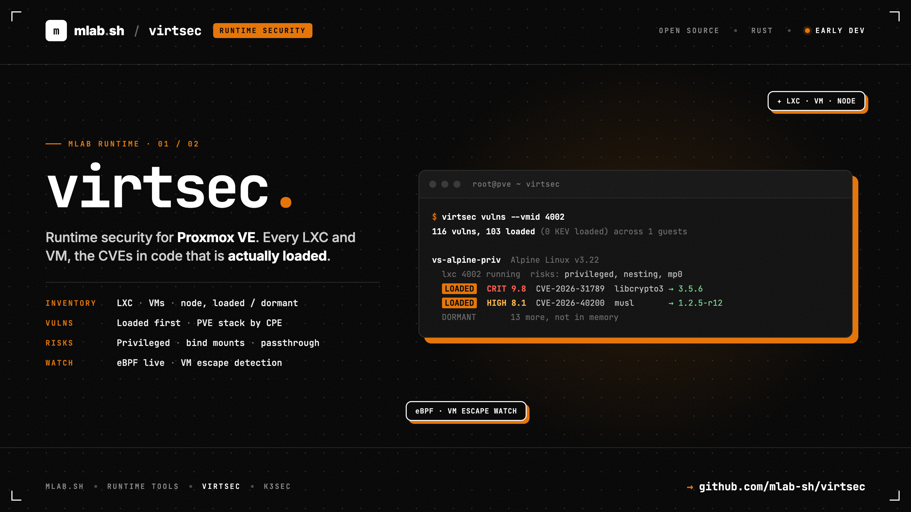

# virtsec



Runtime security CLI for **Proxmox VE** nodes: what runs in every LXC
container and VM, which vulnerabilities touch code that is **actually
loaded**, and what happens on the node, live. Written in Rust. Runs as root on
the node.

> **Early development.** Flags and output may change between releases.

- **Inventory** of every guest and of the node: OS packages, language
  dependencies (LXC), each tagged **loaded** or **dormant**. VMs through
  qemu-guest-agent, opt-in (`--guest-exec`).
- **Vulnerabilities** through [vuln.mlab.sh](https://vuln.mlab.sh), loaded
  first; the PVE stack (QEMU, LXC) by upstream CPE.
- **Isolation risks** from each guest's config: privileged containers, host
  bind mounts, passthrough, raw `lxc.*` / QEMU `args`, hookscripts.
- **A posture audit** of the node: PVE firewall, second factors, API tokens,
  SSH, APT repositories, plus guest risks and restart / reboot needed.
- **A live stream**: execs in guests, outbound connects and sensitive writes
  (eBPF), PVE logins and tasks, config changes, and anything run from a VM's
  QEMU cgroup (a possible VM escape).

```text
$ virtsec vulns --vmid 4002
116 vulns, 103 loaded (0 KEV loaded) across 1 guests

vs-alpine-priv  Alpine Linux v3.22
  lxc 4002 running  risks: privileged, nesting, mp0 host bind mount /var/log (ro)
  116 vulns, 103 loaded
  LOADED        CRIT  9.8  CVE-2026-31789     libcrypto3 3.5.0-r0  → 3.5.6-r0
  LOADED        HIGH  8.1  CVE-2026-40200     musl 1.2.5-r10  → 1.2.5-r12
```

## Documentation

Everything is in the **[wiki](https://github.com/mlab-sh/virtsec/wiki)**
(sources in [`wiki/`](wiki/), synced on every push to `main`), with real
outputs from a test node:

| | |
|---|---|
| Commands | [inventory](https://github.com/mlab-sh/virtsec/wiki/Inventory) · [vulns](https://github.com/mlab-sh/virtsec/wiki/Vulns) · [audit](https://github.com/mlab-sh/virtsec/wiki/Audit) · [watch](https://github.com/mlab-sh/virtsec/wiki/Watch) |
| Details | [Guest risks](https://github.com/mlab-sh/virtsec/wiki/Guest-Risks) · [eBPF probe](https://github.com/mlab-sh/virtsec/wiki/eBPF-Probe) |
| mlab | [Tool API (mlab-agent)](https://github.com/mlab-sh/virtsec/wiki/Tool-API) · [Deployment](https://github.com/mlab-sh/virtsec/wiki/Deployment) |
| Operations | [Known limits](https://github.com/mlab-sh/virtsec/wiki/Known-Limits) · [Development](https://github.com/mlab-sh/virtsec/wiki/Development) |

## Install

Release builds include the eBPF probe and RPM support, for x86_64 Linux
(glibc 2.35+: Proxmox VE 8 and 9).

**apt** (Proxmox VE, Debian)

```bash
sudo install -m 0755 -d /etc/apt/keyrings
sudo curl -fsSL https://apt.mlab.sh/mlab.asc -o /etc/apt/keyrings/mlab.asc
sudo tee /etc/apt/sources.list.d/mlab.sources >/dev/null <<'EOF'
Types: deb
URIs: https://apt.mlab.sh
Suites: stable
Components: main
Architectures: amd64
Signed-By: /etc/apt/keyrings/mlab.asc
EOF
sudo apt update && sudo apt install virtsec
```

**dnf** (Fedora, RHEL and rebuilds)

```bash
sudo curl -fsSL https://pkg.mlab.sh/rpm/mlab.repo -o /etc/yum.repos.d/mlab.repo
sudo dnf install virtsec
```

The signing key is the one every mlab package uses: fingerprint
`717894BC C0E057E4 F9BBF3CA C0E287DD 9609A065`. The packages install
`/usr/bin/virtsec`.

**Prebuilt binary**: tarballs on the
[releases page](https://github.com/mlab-sh/virtsec/releases), with a
`SHA256SUMS` signed keyless by the release workflow:

```bash
cosign verify-blob --bundle SHA256SUMS.sigstore.json \
  --certificate-identity-regexp '^https://github.com/mlab-sh/virtsec/' \
  --certificate-oidc-issuer https://token.actions.githubusercontent.com SHA256SUMS
sha256sum -c SHA256SUMS --ignore-missing
```

## Build

```bash
cargo build --release                   # ./target/release/virtsec
cargo build --release --features rpm    # + RPM-based guests (bundles SQLite)
cargo build --release --features ebpf   # + the eBPF probe (Linux, Rust 1.91+)
```

The eBPF toolchain (nightly, `rust-src`, `bpf-linker`) is on the
[Development](https://github.com/mlab-sh/virtsec/wiki/Development#ebpf) page.

The inventory code and the eBPF probe started as copies of
[k3sec](https://github.com/mlab-sh/k3sec)'s; the two tools are independent.
